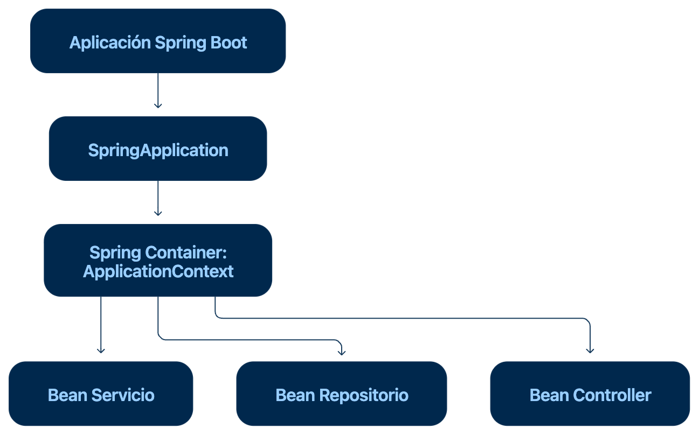

# 1 Ciclo de vida de SpringBoot

- La forma más clara de entenderlo es así:


- El ciclo de vida de Spring Boot corresponde a toda la aplicación.
- El ciclo de vida del ApplicationContext corresponde al contenedor de Spring.
- El ciclo de vida de un bean corresponde a cada objeto administrado por ese contenedor.

De manera simplificada:
```
Ejecutar main()
    ↓
Preparar configuración y propiedades
    ↓
Crear el ApplicationContext
    ↓
Buscar configuraciones y componentes
    ↓
Registrar definiciones de beans
    ↓
Crear e inicializar los beans
    ↓
Iniciar el servidor web
    ↓
Ejecutar ApplicationRunner / CommandLineRunner
    ↓
Aplicación lista para recibir solicitudes
    ↓
La aplicación se detiene
    ↓
Cerrar ApplicationContext
    ↓
Destruir beans
```

# 2. Ciclo de vida del Spring Container
- El Spring Container normalmente está representado por el objeto: ``` ApplicationContext```

- Este contenedor también tiene su propio ciclo:
``` 
Crear ApplicationContext
    ↓
Cargar definiciones de beans
    ↓
Crear e inicializar beans
    ↓
Mantenerlos disponibles
    ↓
Cerrar ApplicationContext
    ↓
Destruir los beans administrados

```
- En una aplicación Spring Boot normalmente tú no construyes manualmente el contexto.

Esto : 

```java
SpringApplication.run(BankingApplication.class, args);
```

Crea el contexto y lo devuelve : 

```java
ConfigurableApplicationContext context =
        SpringApplication.run(BankingApplication.class, args);
```

Por tanto, la siguiente afirmación es correcta:
```
Spring Boot inicia y configura el Spring Container; el Spring Container administra los beans.
```

## ¿Es diferente del ciclo de Spring Boot?

Conceptualmente sí, aunque normalmente ocurren juntos.

- Spring Boot administra el arranque general de la aplicación.
- El ApplicationContext administra los componentes de Spring.
- Cuando Spring Boot se detiene, ordena cerrar el ApplicationContext.
- Al cerrarse el contexto, se inicia la destrucción de los beans.

# 3. Ciclo de vida de un bean

Cada bean tiene un ciclo individual dentro del contenedor.

Por ejemplo : 

```java
@Service
public class TransferService {

    private final AccountRepository accountRepository;

    public TransferService(AccountRepository accountRepository) {
        this.accountRepository = accountRepository;
        System.out.println("1. Constructor ejecutado");
    }

    @PostConstruct
    public void initialize() {
        System.out.println("2. Bean inicializado");
    }

    public void transfer() {
        System.out.println("3. Bean siendo utilizado");
    }

    @PreDestroy
    public void destroy() {
        System.out.println("4. Bean próximo a ser destruido");
    }
}
```

Su ciclo simplificado es:

```
Spring encuentra la definición del bean
    ↓
Ejecuta el constructor
    ↓
Inyecta las dependencias
    ↓
Ejecuta @PostConstruct
    ↓
El bean queda disponible
    ↓
La aplicación utiliza el bean
    ↓
Se cierra el ApplicationContext
    ↓
Ejecuta @PreDestroy
```

### Por tanto, el ciclo del bean sucede dentro del ciclo de vida de la aplicación:

```
Aplicación Spring Boot
┌──────────────────────────────────────────────┐
│                                              │
│  ApplicationContext                         │
│  ┌────────────────────────────────────────┐  │
│  │                                        │  │
│  │ Bean TransferService                   │  │
│  │ crear → inicializar → usar → destruir  │  │
│  │                                        │  │
│  └────────────────────────────────────────┘  │
│                                              │
└──────────────────────────────────────────────┘
```

## Conclusión
- Son conceptos diferentes, pero encadenados:
```
| Ciclo                  | Qué representa                                                      | Quién lo administra  |
| ---------------------- | ------------------------------------------------------------------- | -------------------- |
| Aplicación Spring Boot | Arranque, ejecución y apagado general                               | `SpringApplication`  |
| Spring Container       | Creación, configuración y cierre del contexto                       | `ApplicationContext` |
| Bean                   | Creación, inyección, inicialización, uso y destrucción de un objeto | Spring Container     |


```